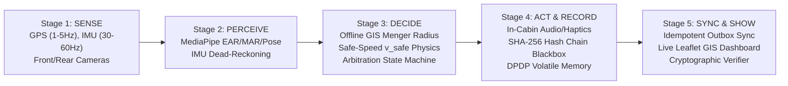

# AI-Driven Commercial Vehicle Safety & Violation Detection System
### Mobile Edge PWA + Cloud Fleet Ecosystem

> **Production Edge-AI commercial vehicle safety platform** featuring on-device computer vision, deterministic IMU dead-reckoning, offline GIS Menger curvature safe-speed physics, cryptographic tamper-evident Blackbox ledger, idempotent offline-first sync, and role-based fleet management compliant with India's **Digital Personal Data Protection (DPDP) Act 2023**.

---

## 1. System Architecture Overview

The system is engineered as a **5-stage real-time pipeline** designed to operate at sub-500ms latency even in remote, mountain, and GPS-denied corridors (such as the Jammu-Srinagar NH44 Patnitop and Chenani-Nashri tunnels):



### Monorepo Structure

```text
CVS_Project/
├── AGENTS.md                  # Principal Architect engineering standards & math specs
├── README.md                  # Root documentation, startup guide & evaluator demo script
├── Docs/                      # Systems Requirement Specifications (SRS) & Patent drafts
├── backend/                   # Python 3.11+ / FastAPI Cloud Fleet Service
│   ├── main.py                # FastAPI endpoints, CORS, WebSocket telemetry manager
│   ├── database.py            # SQLite / PostgreSQL engine & session context managers
│   ├── models.py              # SQLAlchemy 2.0 ORM typed models (Vehicles, Drivers, Violations, Audits)
│   ├── schemas.py             # Pydantic v2 strict data schemas
│   ├── crypto_chain.py        # SHA-256 canonical hash chaining, chain validator, AES evidence encryption
│   ├── gis_engine.py          # Menger curvature, safe speed physics & NH44 Patnitop GeoJSON
│   ├── safety_scorer.py       # FR-13 rolling driver safety score engine (0–100 scale)
│   ├── seed_data.py           # Database seeder & CLI reset tool for baseline fleet & hash chains
│   ├── requirements.txt       # Backend dependencies (fastapi, uvicorn, sqlalchemy, pydantic, etc.)
│   └── tests/
│       └── test_backend.py    # 10 automated test suites (crypto chain, physics, sync, DPDP)
└── frontend/                  # React 19 / Vite Progressive Web App (PWA)
    ├── vite.config.js         # 0.0.0.0 host binding, /api & /ws proxy, HTTPS basic-ssl
    ├── package.json           # Dependencies (@mediapipe/tasks-vision, leaflet, lucide-react, etc.)
    └── src/
        ├── App.jsx            # Multi-role module switcher (Driver, Passenger, Admin Dashboard)
        ├── services/
        │   ├── sensors/       # GPS, IMU gyroscope/accelerometer, mount calibration & NH44 simulator
        │   ├── vision/        # MediaPipe FaceLandmarker (EAR/MAR/Pose) & ObjectDetector (Phone/Occupancy)
        │   ├── engine/        # Offline GIS curve matcher, safe-speed physics & Violation Arbitration
        │   └── storage/       # IndexedDB Blackbox (SHA-256 Web Crypto Subtle) & Outbox synchronizer
        └── views/
            ├── DriverMobileView.jsx     # Speed vs v_safe HUD, Telemetry HUD, In-Cabin Buzzer
            ├── PassengerMobileView.jsx  # Public safety rating, live seat occupancy, Passenger SOS
            └── AdminDashboardView.jsx   # Live GIS fleet map, Hash-Chain Verifier, Audited DPDP viewer
```

---

## 2. Quickstart & Startup Instructions

### Prerequisites
- **Python 3.11+** (virtual environment recommended)
- **Node.js 18+** & **npm**
- Modern Web Browser (Google Chrome, Microsoft Edge, or Safari)

---

### Step 1: Start the Backend Service

1. Open a terminal in the project root:
   ```bash
   cd backend
   ```
2. Activate your virtual environment:
   - **Windows (PowerShell)**:
     ```powershell
     ..\.venv\Scripts\Activate.ps1
     ```
   - **Linux / macOS**:
     ```bash
     source ../.venv/bin/activate
     ```
3. Install backend dependencies (if not already installed):
   ```bash
   pip install -r requirements.txt
   ```
4. Verify/Re-seed baseline demo data:
   ```bash
   python seed_data.py
   ```
   *(To reset database to factory demo state at any time, run: `python seed_data.py --reset`)*
5. Launch the FastAPI server:
   ```bash
   uvicorn main:app --host 0.0.0.0 --port 8000 --reload
   ```

Backend services will be live at:
- **API Base**: `http://localhost:8000`
- **Swagger Documentation**: `http://localhost:8000/docs`
- **Health Check**: `http://localhost:8000/api/health`
- **Hash Chain Verifier**: `http://localhost:8000/api/verify/JK02-1234`
- **WebSocket Telemetry Stream**: `ws://localhost:8000/ws/fleet`

---

### Step 2: Start the Mobile PWA Frontend

1. Open a second terminal in the project root:
   ```bash
   cd frontend
   ```
2. Install frontend dependencies (if not already installed):
   ```bash
   npm install
   ```
3. Start the Vite development server:
   ```bash
   npm run dev
   ```

Vite will output:
```text
  ➜  Local:   https://localhost:5173/
  ➜  Network: https://<YOUR-LOCAL-IP>:5173/
```

> [!NOTE]
> Vite runs with HTTPS enabled via `@vitejs/plugin-basic-ssl`. This is **required** by mobile browsers (Android Chrome and iOS Safari) so that hardware sensor permissions (**Camera**, **Gyroscope**, and **GPS**) can be granted over local Wi-Fi.

---

### Step 3: Run Automated Test Suite

To verify backend physics, cryptographic hash chaining, and DPDP compliance:
```bash
cd backend
python -m pytest tests/ -v
```
All 10 tests will execute and pass, validating:
1. Three-point Menger curvature radius calculation ($R = \frac{a \cdot b \cdot c}{4 \cdot A}$).
2. Safe curve approach speed physics ($v_{\text{safe}} = 3.6 \sqrt{R \cdot g \cdot (e + f)}$).
3. Dynamic braking reaction warning distance ($d_{\text{warn}}$).
4. Reduced lateral friction during IMU Dead-Reckoning ($f = 0.1275$).
5. SHA-256 canonical hash chaining from `GENESIS_0000000000000000`.
6. Automatic tamper detection identifying broken hash chain links.
7. Idempotent Outbox deduplication by client UUID.
8. GPS-denied tunnel delayed-arrival flagging (`arrived_late = True`).
9. Rolling driver safety score computation (FR-13).
10. DPDP Act 2023 role-scoped evidence access and cryptographic watermarking.

---

## 3. Smartphone Testing Guide (Real GPS, IMU, & Camera)

You can run and test the live PWA on any physical iOS or Android smartphone using either **Method A (Local Wi-Fi)** or **Method B (USB Port Forwarding)**:

### Method A: Over Local Wi-Fi (Quickest Wireless Setup)
1. Ensure your smartphone and laptop/PC are connected to the **same Wi-Fi network**.
2. Note the network URL output by Vite in Step 2:
   ```text
   https://192.168.x.x:5173/
   ```
3. Open **Chrome** (Android) or **Safari** (iOS) on your phone and navigate to `https://192.168.x.x:5173/`.
4. **Accept Self-Signed Certificate**:
   - Chrome: Tap **Advanced** $\to$ **Proceed to 192.168.x.x (unsafe)**.
   - Safari: Tap **Show Details** $\to$ **visit this website** $\to$ confirm passcode/biometrics.
5. In the Driver View:
   - Tap **"Start Telemetry"** or **"Calibrate Sensors"** $\to$ tap **Allow** on the browser permission prompts for **Location** (GPS) and **Motion & Orientation** (IMU Gyroscope).
   - In the Vision panel, tap **"Start Camera"** $\to$ tap **Allow** for Camera access.

### Method B: Over USB Cable via Chrome DevTools (Zero Certificate Prompts)
1. Connect your Android phone to your PC via USB cable and enable **USB Debugging**.
2. Open Google Chrome on your PC and navigate to:
   ```text
   chrome://inspect/#devices
   ```
3. Click **Port Forwarding...** and add the rules:
   - `5173` $\to$ `localhost:5173`
   - `8000` $\to$ `localhost:8000`
4. On your smartphone's Chrome browser, open:
   ```text
   http://localhost:5173/
   ```
5. Because `localhost` is treated as a secure context, camera and sensor permissions work instantly with zero certificate warnings.

### Method C: Laptop / Desktop Simulator Fallback
If testing without physical vehicle motion or without a smartphone:
1. Open `https://localhost:5173/` in your browser.
2. The Driver view includes a built-in **Interactive NH44 Mountain Route Simulator** that streams pre-recorded high-resolution telemetry across hairpin curves and the Chenani-Nashri tunnel.
3. The Vision panel includes synthetic scenario buttons (**NORMAL**, **DROWSY**, **DISTRACTED**, **PHONE USE**, **OVERCROWDED**) to trigger the full detection pipeline without a webcam.

---

## 4. 4-Minute Evaluator Demo Script & Walkthrough

Follow this step-by-step walkthrough during live evaluations to showcase the entire 5-stage pipeline across all 3 user roles:

| Time | Stage | Action / Demonstration | Expected System Response & Observation |
|---|---|---|---|
| **0:00 – 0:45** | **Driver HUD & Safe-Speed Physics (FR-6, FR-7)** | 1. Open the PWA at `https://localhost:5173/` (Driver View).<br>2. Select vehicle `JK02-1234`.<br>3. Under Telemetry Controls, click **"Start NH44 Patnitop Route Simulation"**. | • Speedometer shows real-time speed approaching Patnitop Hairpin Bend 1.<br>• Menger curvature calculates radius $R = 31.8\text{ m}$, generating safe curve speed $v_{\text{safe}} = 26.5\text{ km/h}$.<br>• As speed ($38\text{ km/h}$) exceeds $v_{\text{safe}}$ inside warning distance ($d_{\text{warn}}$), HUD turns amber, warning chime sounds, and speech synthesizer announces: *"Caution: Sharp curve ahead, reduce speed to 27 kilometers per hour."* |
| **0:45 – 1:30** | **Edge Vision & Distraction Arbitration (FR-4, FR-13a)** | 1. In the Vision Pipeline panel, click **"Start Camera"** (or use synthetic simulation).<br>2. Click **"Drowsy (EAR < 0.20)"** or close eyes for 2 seconds.<br>3. Next, click **"Distracted (Yaw > 30°)"** or **"Phone Use"**. | • Real-time Eye Aspect Ratio (EAR) metric drops below $0.21$.<br>• Violation Arbitration Engine debounces for $1.8\text{ s}$ to prevent false positives.<br>• Dual-tone buzzer chimes, and critical alert activates: *"Drowsiness detected, please focus on the road."*<br>• Outbox queue increments and logs event locally. |
| **1:30 – 2:15** | **GPS-Denied Dead-Reckoning (FR-8, NFR-1)** | 1. In Route Simulator, click **"Enter Chenani Tunnel (Drop GPS)"**.<br>2. Observe the Telemetry Status Badge and Map. | • Sensor mode immediately flips from `GPS_LOCKED` (green) to `IMU_DEAD_RECKONING` (cyan).<br>• A 30-second bounded grace window countdown starts.<br>• Complementary filter fuses forward acceleration and gyroscope yaw rate ($\omega_z$) to track position through the tunnel.<br>• Safe-speed friction limit $f$ automatically reduces by 15% ($f = 0.1275$) to account for dead-reckoning uncertainty.<br>• Violations occurring inside the tunnel are tagged with `sensor_mode: "IMU_DEAD_RECKONING"`. |
| **2:15 – 3:00** | **Cryptographic Blackbox & Tamper Verifier (FR-11)** | 1. Switch to the **Fleet Operations Center & RTO Dashboard** (`ADMIN` tab).<br>2. Select vehicle `JK02-1234` and view the **Cryptographic Hash-Chain Ledger**.<br>3. Click **"Verify Hash Chain"**.<br>4. Now click **"Simulate Illegal Database Tamper"** to modify a record speed.<br>5. Click **"Verify Hash Chain"** again. | • Pristine verification displays **"CHAIN INTACT: 100% Valid"** with green hash badges connecting `GENESIS` $\to$ Block 1 $\to$ Block 2 $\to$ Block 3.<br>• After tamper simulation, the verifier instantly isolates the tampered row in bright red:<br>  `[TAMPER DETECTED at Block #2]: Recomputed hash does not match stored hash!`<br>• Demonstrates non-repudiation for regulatory enforcement. |
| **3:00 – 3:30** | **DPDP Act 2023 Audited Evidence Access (NFR-4)** | 1. In the Violation Feed on the Admin Dashboard, locate a confirmed violation.<br>2. Select Role as `TRANSPORT_AUTHORITY` and click **"View Evidence Snapshot"**.<br>3. Inspect the rendered evidence dialog and the bottom **Audit Log** table. | • Server decrypts evidence snapshot strictly in volatile memory.<br>• Evidence image displays a dynamic cryptographic watermark overlay with inspector ID, purpose, and timestamp.<br>• An immutable record is created in `AuditLog` table documenting who viewed the evidence, their role, and statutory reason. |
| **3:30 – 4:00** | **Passenger Safety Module & Crowdsourced SOS (SRS §10.2)** | 1. Switch to the **Passenger View** (`PASSENGER` tab).<br>2. Observe the Public Route Safety Rating ($92.5/100$) and live occupancy indicator.<br>3. Click **"Submit Feedback"** or press the **"Emergency Passenger SOS"** button. | • Passenger sees live bus tracking and safety compliance score.<br>• SOS triggers an instant high-priority red banner on the Admin Operations Dashboard via WebSocket broadcast (`ws://localhost:8000/ws/fleet`). |

---

## 5. Key API Reference & Verification Endpoints

| Method | Endpoint | Description |
|---|---|---|
| `GET` | `/api/health` | System health status, database connection, registered fleet statistics |
| `GET` | `/api/verify/{registration}` | Validates sequential SHA-256 cryptographic Blackbox hash chain |
| `POST` | `/api/demo/tamper/{event_id}` | Deliberately modifies a stored record to demonstrate tamper detection |
| `POST` | `/api/sync/outbox` | Idempotent Outbox batch ingestion from mobile IndexedDB Blackbox |
| `POST` | `/api/telemetry/heartbeat` | Live vehicle GPS/IMU stream + WebSocket fleet broadcast |
| `GET` | `/api/evidence/{event_id}` | DPDP Act 2023 role-scoped decrypted evidence with dynamic watermark |
| `GET` | `/api/gis/cached-tiles` | Offline road GeoJSON geometry (NH44 Patnitop hairpin curve segments) |
| `POST` | `/api/gis/evaluate` | Lookahead Menger curvature and safe-speed curve evaluator |
| `GET` | `/api/vehicles` | All fleet vehicles, live coordinates, and sensor modes |
| `GET` | `/api/drivers` | Registered commercial drivers and rolling safety scores |
| `POST` | `/api/feedback` | Passenger trip ratings, crowdsourced comments, and SOS alerts |
| `GET` | `/api/audit-logs` | Regulatory compliance access logs for all evidence reviews |
| `POST` | `/api/demo/reset` | Resets demo vehicles and baseline hash chains to pristine state |
| `WS` | `/ws/fleet` | Real-time bidirectional WebSocket stream for operations center |

---

## 6. Mathematical Formulas & Standards Reference

1. **Menger Curvature Radius (IRC:73 Mountain Highways)**:
   $$R = \frac{a \cdot b \cdot c}{4 \cdot A}$$
   where $a, b, c$ are Euclidean segment lengths between three consecutive road vertices projected in local meters, and $A$ is the triangle area computed via 2D cross-product.

2. **Maximum Safe Curve Approach Speed**:
   $$v_{\text{safe}} = 3.6 \cdot \sqrt{R \cdot g \cdot (e + f)} \quad (\text{km/h})$$
   with gravitational acceleration $g = 9.81\text{ m/s}^2$, highway superelevation $e = 0.07$, and conservative lateral friction factor $f = 0.15$ (automatically derated to $f = 0.1275$ during dead-reckoning).

3. **Advance Warning Distance**:
   $$d_{\text{warn}} = (v_{\text{m/s}} \cdot t_{\text{reaction}}) + \frac{v_{\text{m/s}}^2}{2 \cdot g \cdot (\mu \pm \text{gradient})}$$
   with driver reaction time $t_{\text{reaction}} = 2.0\text{ s}$ and road braking coefficient $\mu = 0.35$.

4. **Cryptographic Blackbox Hash Chaining (FR-11)**:
   $$\text{record\_hash}_i = \text{SHA256}\Big(\text{prev\_hash}_i + \text{canonical\_json}(\text{payload}_i)\Big)$$
   where $\text{prev\_hash}_1 = \text{"GENESIS\_0000000000000000"}$. Any bitwise alteration of past records invalidates all subsequent hashes in the ledger.

5. **Complementary Sensor Fusion (GPS-Locked Mode)**:
   $$\theta_t = 0.96 \cdot (\theta_{t-1} + \omega_z \cdot \Delta t) + 0.04 \cdot \theta_{\text{GPS}}$$

---

## 7. License & Compliance
Built in strict conformance with:
- **Ministry of Road Transport and Highways (MoRTH) / IRC:73 Standards** for mountain highway curve geometry.
- **Digital Personal Data Protection (DPDP) Act 2023 (India)** for volatile edge vision inference, audited evidence retrieval, and encrypted record archival.
